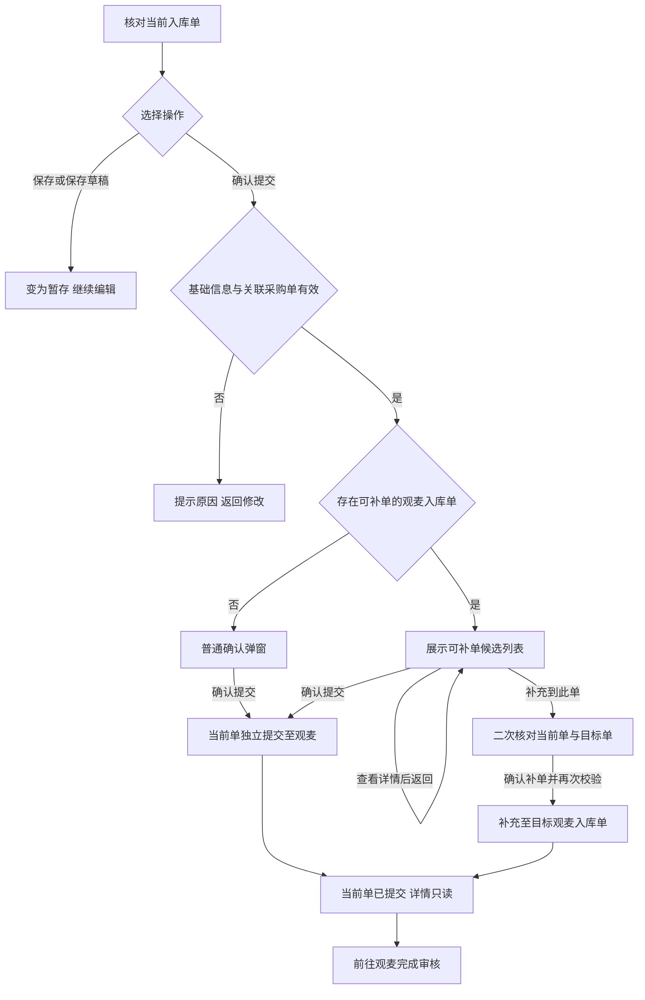

# 采购录单产品需求说明

整理日期：2026-11-03  
适用原型：根目录 `index.html` 中的采购录单场景。  
说明口径：按当前界面、交互逻辑整理；演示能力和待收敛规则集中列于第 12 节。

## 1 业务范围

采购操作员将采购计划、供应商到货消息及附件交给 AI 识别，经人工核对后生成采购单或采购入库单，并提交至观麦。

| 业务对象 | 用途 | 处理结果 |
|---|---|---|
| 采购单 | 记录计划采购的供应商、商品、数量和备注 | 按供应商分组确认提交，交由观麦审核 |
| 采购入库单 | 记录本批实际收货的商品、数量、价格和异常备注 | 保存，或独立提交，或补充至观麦待审核入库单 |
| 采购单与入库单关系 | 支持正常送货、分批送货及先入库后补采购单关系 | 一张采购单可对应多张入库单；每张入库单最多关联一张采购单，也允许不关联 |

**确认提交只表示提交至观麦，观麦审核由观麦操作员完成。**本期不包含采购退货、退入库，以及一张入库单关联多张采购单的场景。

主要使用者为采购操作员；系统管理员通过公共入口管理成员、角色及额度。供应商是单据业务对象，不作为本后台操作角色。

## 2 页面与导航

整体采用“左侧图标导航＋顶部页面标签＋内容区”。左侧导航悬停或聚焦后展开子菜单；已打开页面可通过顶部标签切换、关闭。顶部标明企业和“采购录单”，支持切换销售录单；管理员菜单提供成员管理、额度管理入口。

| 页面 | 主要界面与功能 |
|---|---|
| 首页 | 快捷入口、今日任务、跨系统同步看板、采购单及采购入库单群聊看板 |
| 采购单录入 | 选择供应商或采购单群，输入采购计划或上传附件 |
| 采购单审核 | 筛选任务、调整操作员、查看详情、核对并按分组提交 |
| 采购入库单录入 | 选择供应商或入库群，输入实际到货内容或上传附件 |
| 采购入库单审核 | 筛选任务，进入详情核对、关联采购单、保存或确认提交 |
| 供应商管理 | 查询供应商资料、群绑定、已同步 SKU 和备注优先级 |
| 群聊管理 | 维护来源群、单据类型、供应商和成员归属、默认操作员 |
| 提示词 | 按单据类型管理供应商提示词、系统提示词 |
| AI 记忆 | 查看供应商商品修正、采购习惯、常购商品及群内供应商名称映射 |
| 统计 | 按时间查看操作员下单数、提交数、商品总数，提供 Excel 导出入口 |
| 设置 | 机器人管理、回复设置、采购入库金额计算优先级 |

“决策大屏”“供应商分组”当前已隐藏，不计入可用功能范围；PRD 首页、业务说明和批注属于原型评审工具。

## 3 首页

| 区域 | 展示内容 | 交互 |
|---|---|---|
| 快捷入口 | 两类单据录入及审核、供应商、群聊、提示词、AI 记忆、设置 | 点击进入对应页面 |
| 今日任务 | 采购单：待处理、已提交、失败、活跃群；入库单：暂存、待处理、已提交、活跃群 | 状态数量和“去处理”进入对应审核列表；当前不自动带入状态筛选，活跃群入口进入群聊管理 |
| 跨系统同步看板 | 可补单批次、已审核批次；采购单号、来源、供应商、观麦业务状态、入库确认提示 | 只读查看跨系统状态；可补单批次仍需在详情中按供应商和时间进一步匹配 |
| 群聊看板 | 采购单群、入库单群分别展示群名称、待办、完成、异常数量 | “全部”进入群聊管理 |

采购单来源区分观麦录入与 AI 录单提交；观麦已审核或已关闭的采购单不能新增入库关联。

## 4 单据录入

两类录入页共用布局：左侧为来源页签、搜索框及来源列表，右侧为录入区域，底部提供文本框、上传和发送入口。

| 项目 | 采购单录入 | 采购入库单录入 |
|---|---|---|
| 来源页签 | 供应商、群聊；群聊仅展示采购单录入群 | 供应商、群聊；群聊仅展示采购入库单录入群 |
| 典型输入 | 采购计划、手写采购单、微信截图 | 送货单、到货消息、复称及缺货说明 |
| 输入形式 | 文字、图片、Excel、PDF；提供拖拽、粘贴、上传入口 | 同左 |
| 识别重点 | 供应商、商品、采购数量、单位、采购备注；价格可待人工补充 | 供应商、商品、到货数量、单位、单价及送货备注 |
| 输出任务 | 待处理采购单 | 待处理采购入库单 |

操作顺序：选择来源 → 输入文字或添加附件 → 发送识别 → 进入对应审核列表核对。选择来源本身不触发识别；输入为空时点击发送，提示“请输入录单内容”。两类录入分别生成各自任务，不因录入采购单而自动生成入库单或建立关联。

来源搜索按当前页签切换供应商名称／ID、群聊名称／ID；页面提供收起侧栏入口。来源选择、附件上传和识别结果落单尚属演示范围，见第 12 节。

## 5 审核列表

### 5.1 筛选及操作布局

| 项目 | 采购单审核 | 采购入库单审核 |
|---|---|---|
| 状态选项 | 全部、待处理、已提交、失败 | 全部、待处理、暂存、已提交 |
| 日期条件 | 采购时间，开始日期至结束日期 | 入库时间，开始日期至结束日期 |
| 其他条件 | 群聊、操作员、供应商 | 同左 |
| 筛选区按钮 | 查询、重置 | 查询、重置 |
| 列表工具栏 | 刷新、合单 | 刷新、合单 |

查询使用组合条件；重置恢复默认条件；刷新保留当前条件。日期控件采用范围选择，页面内日期是演示值。当前实际数据过滤以状态为主，其他条件的查询联动尚未完整接入。

两类列表的“合单”均为本地待处理任务整理入口，当前仅提示选择两张或多张待处理单据。该入口与详情中向观麦入库单追加内容的“补单”分别定义，不代表允许一张入库单关联多张采购单。

### 5.2 列表字段及行操作

共同字段：**状态、时间、群聊、供应商、原文、商品数、操作员、操作**。商品数按明细行数统计，不是数量合计；原文用于追溯，不能被人工修正结果覆盖。

| 操作 | 规则 |
|---|---|
| 操作员下拉 | 用于调整当前处理人；已提交入库单改为只读文本 |
| 查看 | 进入相应单据详情，列表不直接执行确认提交 |
| 重识别 | 重新解析原文，用于识别错误或规则调整后的重试；已提交入库单不展示 |
| 删除 | 处理未提交任务；已提交入库单不展示。当前删除仅作提示 |

入库列表额外展示“送货情况”，表头已注明**仅用于评审、不作为开发字段**。当前列表没有独立“关联采购单”列，关联操作在详情完成。采购单提交后的操作锁定尚未与入库单统一，见第 12 节。

## 6 采购单详情

### 6.1 界面

左侧展示原始文件和原始消息，提供“基本信息”“群聊消息”来源页签；默认激活群聊消息，“定位来源”为其附加操作。右侧展示单据状态、操作员、来源群聊、字段设置，以及纵向排列的采购单分组。

每个分组包含：分组名称、供应商下拉、采购备注、商品明细，以及“更多／删除分组”“确认提交”。底部提供“新增订单分组”。

### 6.2 分组与明细交互

1. 一个任务可拆成多个采购单分组，各组独立选择供应商、填写采购备注并确认提交。
2. 支持新增、删除分组，至少保留一个分组；切换供应商不自动清空原商品明细，需操作员核对。
3. 支持组内新增、删除商品，至少保留一行；商品名称、数量／单位、单价、总价和备注可编辑，识别文本只读。
4. 商品名称输入时展示搜索候选，列出商品名称、规格名、采购规格、采购单位、规格 ID；点击或按 Enter 选择并带入商品信息，无匹配时显示空结果。
5. 数量或单价变化时重新计算总价，保留两位小数；总价也可直接修改。采购单目前没有入库单的“人工金额锁定”规则，后续修改数量或单价会重新计算。
6. 点击分组“确认提交”，当前校验供应商、至少一行商品和商品名称。成功后该组按钮变为“已提交”；部分组提交时任务为“部分提交”，全部组提交时为“已提交”。

已提交组不能重复点击提交；字段编辑、删除分组、已提交采购单行操作的锁定规则仍需收敛。

## 7 采购入库单详情

### 7.1 界面与字段

左侧为来源资料，结构同采购单详情。右侧从上到下为：标题及状态、来源群聊／观麦入库单号、供应商和入库时间配置、关联采购单、商品明细。供应商和入库时间位于配置区，关联采购单在其右侧；商品表格支持横向滚动。

| 字段 | 含义与交互 |
|---|---|
| 供应商 | 可输入下拉，支持选择已有供应商或输入自定义名称；去除首尾空格后生效 |
| 入库时间 | 一个完整日期和时间点，用于补单候选判断；初始取任务时间 |
| 关联采购单 | 可选、单选；候选展示采购单号、来源及采购日期 |
| 识别文本 | AI 识别的商品原文，只读 |
| 商品名称 | 人工核对后的商品；支持与采购单详情相同的商品搜索 |
| 入库数量（采购单位） | 当前批次实收数量，可编辑；确认提交时必须大于 0 |
| 入库数量（基本单位） | 基本单位口径的收货数量，当前可编辑；选商品时带入换算结果 |
| 采购数量 | 关联采购单中对应商品的数量，只读；未关联或未匹配到商品时为空 |
| 差异 | 采购数量减本批入库数量，只读；无采购数量时为空 |
| 单价、总价 | 可编辑；总价按计算优先级生成默认值，也允许人工覆盖 |
| 备注 | 记录复称、破损、短缺等本批收货说明 |

采购数量按商品名称或标准商品名称及单位匹配。分批场景下比较的是**采购单数量与当前批次实收数**，当前不计算累计已收数量或剩余待收数量。

可编辑详情提供顶部“保存、删除”，以及明细区“保存草稿、确认提交”和新增／删除商品入口。“保存”和“保存草稿”均将当前单变为暂存，不提交观麦，不联动其他批次。

### 7.2 供应商与采购单关联

- 供应商选择、失焦或按 Enter 后生效，随即刷新候选采购单。
- 候选只包含同供应商、所选时间范围内、已提交观麦且尚未审核、未关闭的采购单。
- 时间范围默认近 1 天，可切换近 3 天、近 7 天、全部时间；切换后仍保留已选采购单展示。
- 可选择“不关联采购单”，不影响独立确认提交；更换关联时替换原关系，不追加第二张采购单。
- 新供应商与已关联采购单不一致时，先提示将解除原关联；确认后应用新供应商并解除原关系，取消则保留原值和关联。
- 已关联采购单变为已审核或不可用时，阻止进入提交确认，要求解除或更换关联。

### 7.3 数量差异与金额

| 规则 | 产品口径 |
|---|---|
| 数量换算 | 入库数量（基本单位）＝入库数量（采购单位）×每采购单位对应的基本单位数量。例如 8 袋、10 千克／袋，对应 80 千克；持续联动及人工修改规则见第 12 节 |
| 差异计算 | 差异＝采购数量－本批入库数量（采购单位）；正值为少收，负值为多收 |
| 高亮条件 | 采购数量大于 0，且绝对差异／采购数量严格大于 10%；等于 10% 不高亮 |
| 高亮表现 | 高亮商品行及采购数量、入库数量、差异单元格，不展示偏差百分比标签；仅提醒，不阻断提交 |
| 默认金额 | 计算基准数量×单价；默认使用实收数量，配置项见第 10 节 |
| 人工金额 | 直接修改总价后保留人工值，后续调整实收数或单价不自动覆盖该行总价 |

### 7.4 确认提交与补单

提交前检查供应商、有效入库日期时间、至少一条商品、商品名称、单位、入库数量大于 0，以及已关联采购单供应商一致且仍可用。失败时保留编辑内容并提示原因。

**补单候选必须同时满足以下条件：**

1. 与当前单供应商名称一致，且不是当前单自身。
2. 目标任务时间与当前填写的入库时间属于同一天，且不晚于该时间点。
3. 目标已成功提交至观麦，存在观麦入库单号，且观麦尚未审核。

候选按观麦入库单号去重、按时间倒序展示；不要求当前单先关联采购单，也不以相同采购单为必要条件。已审核历史批次不能继续补单，后续批次可独立提交。

| 弹窗 | 展示与操作 |
|---|---|
| 普通确认提交 | 仅展示是否提交当前单及提交至观麦的结果说明；按钮为取消、确认提交，不重复展示商品数或差异 |
| 存在可补单的入库单 | 展示候选单号、时间、商品数；每行提供查看详情、补充到此单。底部保留取消、确认提交，允许忽略候选独立提交 |
| 候选详情 | 只读展示供应商、时间、商品数及商品名称、实收数量、单价、金额、备注；点击“返回补单选择”回到候选列表 |
| 补单二次确认 | 展示当前单、目标单及可选关联采购单的商品数，核对供应商和双方时间；提供返回核对、确认补单。目标状态失效时停止补单并提示重新选择 |

关闭或取消弹窗不改变单据状态，确认弹窗不提供暂存按钮。商品数始终表示各单明细行数，不代表系统已完成逐商品对账。补单后保留本地批次来源关系，当前单使用目标观麦入库单号。

### 7.5 提交后的展示

独立提交或补单成功后，当前单变为“已提交”，展示处理结果、观麦入库单号和“请前往观麦系统完成审核”提示。供应商、时间、关联关系及明细均只读；隐藏删除、保存、确认提交和新增／删除商品入口，重复提交会被拦截。

其他待处理或暂存批次不会随当前单自动提交。观麦已审核记录展示“已审核”，与本地“已提交”区分。

## 8 明细字段设置

入口为两类详情顶部“字段设置”。采购单、采购入库单分别配置，互不影响；**必选字段表示必须展示，不等于字段值必须填写**。

| 单据类型 | 必选字段 | 可选字段 | 预置自定义字段 |
|---|---|---|---|
| 采购单 | 识别文本、商品名称、数量／单位、单价 | 总价、备注、商品自定义编码、采购单（采购单位） | 采购用途、到货要求、供应商货号 |
| 采购入库单 | 识别文本、商品名称、入库数量（采购单位）、入库数量（基本单位）、采购数量、差异 | 单价、总价、备注、商品自定义编码、损耗数（基本单位） | 到货批次、到货温层、质检要求 |

- 采购单默认显示必选字段及总价、备注；入库单默认显示必选字段及单价、总价、备注。
- 弹窗左侧按分类勾选，支持字段名称搜索；右侧展示已显示字段，全部字段均可拖拽排序，必选字段不能移除。
- 支持刷新字段、恢复默认；保存后应用到当前单据类型的明细表，取消放弃本次调整。
- 当前只选择既有字段，不提供在此新增字段定义的能力；配置跨刷新、跨账号的保存范围尚未定义。

## 9 供应商与群聊

### 9.1 供应商管理

筛选区提供名称／ID／地址搜索、群绑定状态、查询和重置。汇总展示总供应商、已绑群供应商、有已同步 SKU 的供应商数；最后一项不是 SKU 行数合计。

列表字段为供应商 ID、名称、联系人、地址、电话、群绑定、已同步 SKU 数、备注优先级。备注优先级展示采购备注、SPU 备注及合并等策略，提供编辑入口；当前未提供新增、删除供应商入口。

### 9.2 群聊管理

| 区域 | 内容与交互 |
|---|---|
| 筛选及工具栏 | 群聊类型、操作员、群名称搜索；批量删除、群聊迁移、新增邮件群、刷新 |
| 汇总及列表 | 汇总总群聊、已绑供应商、采购单群、入库单群、已禁言；列表展示群名称、单据类型、信道类型、供应商数、成员数、操作员、发言状态、采购时段、详情及删除 |
| 详情基本信息 | 展示群状态、成员数、绑定供应商数、机器人发言及下单时段，操作员采用下拉选择 |
| 供应商列表页签 | 展示已绑定供应商名称和 ID，提供供应商管理、删除绑定入口 |
| 群成员页签 | 展示成员名称、微信号、身份类型、绑定供应商；通过下拉维护成员与供应商的对应关系 |

群聊类型决定消息进入采购单还是采购入库单链路；信道类型展示企微、个微、邮件等来源。一个群可绑定多个供应商，成员归属辅助识别。详情中发言状态、时段当前只读，配置保存和维护动作多数仍为演示。

## 10 知识配置与设置

### 10.1 提示词

按“采购单／采购入库单”切换，再按“供应商提示词／系统提示词”管理。列表展示模板名称、类型、绑定范围、启停状态、Prompt 预览、更新时间及编辑／删除操作，并提供搜索、新建模板入口。

模板编辑包含名称、固定单据类型、启用状态、可选按群聊绑定、供应商多选及追加 Prompt。名称和追加 Prompt 为必填，供应商留空表示当前租户全部供应商；追加内容接在系统基础 Prompt 后，不覆盖核心解析规则。取消不保存，禁用模板不参与后续解析；两类单据模板隔离。

### 10.2 AI 记忆

当前一级页签为“供应商记忆／群聊记忆”，未提供采购单／入库单一级切换。

| 记忆类型 | 列表与详情 |
|---|---|
| 供应商记忆 | 按供应商名称／ID搜索；汇总商品修正、采购习惯、常购商品、累计单据、最近采购与更新时间 |
| 商品修正 | 详情展示原始输入、匹配商品、命中次数、状态、来源、更新时间；支持新增、编辑、删除入口。维护字段为原始输入、目标商品及可选目标单位 |
| 采购习惯 | 展示日期、单位、备注等规则内容、命中次数、更新时间及编辑入口 |
| 常购商品 | 详情内区分采购单／采购入库单，展示规格、次数、累计数量、基本单位、常用备注；来自历史同步聚合，只读，不在此直接删除 |
| 群聊记忆 | 按群名称搜索，汇总供应商数、映射条目数、累计命中和更新时间；详情维护“供应商原始称呼→标准供应商”的映射，同一称呼按群独立生效 |

### 10.3 机器人与回复

- **机器人管理：**展示绑定数、在线数，以及机器人名称、接入类型、状态、详情和刷新入口。
- **回复设置：**分别配置采购单已收到、采购入库单已收到、整单转换、提交审核通知；各场景提供回复／通知开关、商品明细显示开关、恢复默认和保存。
- **共享租户约束：**使用系统内置回复，只允许维护开关及是否显示商品明细；当前输入框可编辑的表现与此约束不一致，需收敛。

### 10.4 计算优先级

| 配置 | 金额基准数量 |
|---|---|
| 默认设置级 | 固定使用实收数，自定义下拉禁用 |
| 自定义设置 | 单选实收数优先、采购数优先、取两者最小值 |

两个配置级别互斥。总价＝基准数量×单价；未关联或未匹配到采购数量时，当前按实收数作为回退值。规则只影响入库默认金额，不改变“采购数量－实收数”的差异计算。页面提供保存；已人工修改金额的行继续保留人工值。

## 11 统计与验收要点

统计页提供“操作员绩效”，时间可选今日、昨日、本周、本月、上月或自定义开始／结束日期；表格为序号、操作员、下单数、提交数、商品总数，提供按当前条件导出 Excel 的入口。商品总数表示明细行数，采购单与入库单的合计及去重口径需确认。

| 验收场景 | 预期结果 |
|---|---|
| 切换两类录入群来源 | 只出现对应单据类型群，不混入另一类群 |
| 分别提交多个采购单分组 | 仅处理当前组；任务先为部分提交，全部组完成后为已提交 |
| 修改已关联入库单的供应商 | 确认后才解除原关联；取消完整保留原值和关系 |
| 不关联采购单提交入库 | 基础信息完整时允许独立提交，采购数量和差异为空 |
| 采购 100、实收 90 与 89 | 90 时不高亮，89 时高亮；均不因差异而阻断提交 |
| 修改实收数、单价及人工总价 | 默认金额按配置计算；总价人工修改后不被后续数量、单价覆盖 |
| 同供应商、跨日／晚于当前时间／已审核目标 | 均不进入可补单候选；满足全部条件的目标可选 |
| 存在候选时点击底部确认提交 | 当前单独立提交，不自动补入候选单 |
| 点击补充到此单 | 先二次确认，再复核目标状态；失效则停止补单 |
| 入库提交成功后再次打开 | 详情只读、无重复提交入口，其他批次状态不变 |
| 调整字段显示和顺序 | 必选字段保留，保存后列顺序一致，两类单据配置互不影响 |

## 12 原型边界与待确认

当前为静态交互原型，AI 识别、真实落单、观麦同步、配置持久化和 Excel 导出尚未形成真实业务闭环。下表事项需在开发前收敛，不能将提示成功视为已完成对接。

| 事项 | 当前表现及需明确内容 |
|---|---|
| 演示入口 | 来源搜索／选中、附件上传、侧栏收起、来源页签切换／定位／下载、重识别、删除、列表合单、群维护、模板／记忆保存等包含仅展示或提示的交互，需补齐实际动作与结果反馈 |
| 状态与锁定 | 采购单存在部分提交，但筛选未单列；已提交组仍可改字段、删除。需统一提交后编辑、删除、重识别及负责人调整权限 |
| 时间口径 | 审核列表日期为演示值；候选采购单“近 N 天”当前以同供应商样例的最新采购日期为参照。正式采用当前日还是入库日、是否含当天及两端边界需明确；补单目标当前取任务生成时间，是否改用业务入库时间需确认 |
| 数量与价格 | 双单位数量尚未完整实现修改后的自动换算；需明确基本单位手改、反算、无规格和精度规则。采购单数量／单位校验、入库单零价／缺价及人工金额异常的处理规则也需明确 |
| 合单与补单 | 列表合单尚无选择及确认流程；需明确允许状态、供应商条件、合并结果。观麦补单需明确同商品追加还是合并数量，以及原批次保留和结果回传方式 |
| 配置及权限 | 字段设置、金额规则等目前主要保存在当前页面会话；需明确用户／租户配置范围、保存生效时点、管理员及金额查看权限。共享租户默认回复应收敛为只读 |
| 统计与同步 | 需明确统计日期字段、两类单据及分组／补单的计数和去重口径；观麦提交须覆盖失败重试、结果不明确查询、重复提交拦截及并发状态变化处理 |

原型依据：`index.html`、`app.js`、`styles.css`；字段配置参照 `docs/requirements/purchase-audit-field-settings.md`。旧 `purchase-field-spec.md`、页面批注中与当前界面不同的布局、字段及“合单／补单”用语，不直接作为当前界面结论。
