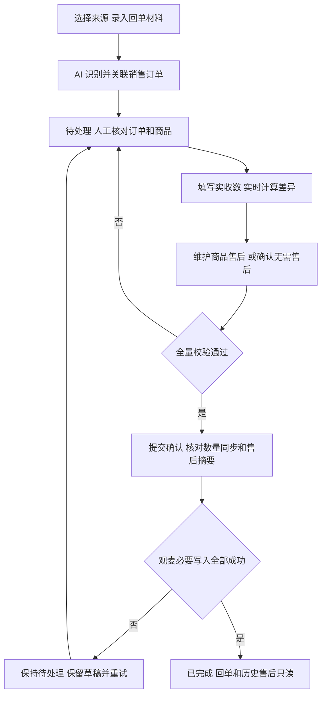

# 销售回单产品需求说明

整理日期：2026-11-03  
适用范围：销售录单中的销售回单审核、录入及相关配置。

## 1 业务范围与状态

回单操作员核对商户的实际收货结果，确认销售订单关联、实收数量及商品售后，再提交至观麦。原始文件和消息只读保留；销售订单下单数始终不改写，数量差异以出库数为基准。

| 状态 | 含义 | 可执行操作 |
|---|---|---|
| 识别中 | AI 正在读取材料、识别主体、匹配订单和解析数量 | 查看进度、刷新；不允许编辑，不进入回单审核列表 |
| 待处理 | 已有识别结果，仍需关联、核对、补全售后或处理同步异常 | 编辑、保存草稿、确认提交、填写原因后作废 |
| 已完成 | 本次回单及应执行的观麦同步已成功完成 | 原回单及历史售后只读；完成页售后入口的边界见第 11 节 |
| 已作废 | 待处理任务被操作员终止 | 保留记录和原因，停止审核、提交与数量联动；当前列表移除查看及作废入口 |

当前支持商品核对、单商品单条售后、商品退货；非商品异常和同商品多条售后不在当前提交流程中。销售订单与回单按一对一口径关联，跨任务唯一性需正式校验。

## 2 导航与页面

销售回单已集成到销售录单壳层，顶部显示企业和“销售录单”。左侧“销售回单”展开“回单审核、回单录入”；客户、群聊、统计和设置使用共享入口。回单模块未开通或无权限时隐藏入口，直达页面展示未开通或无权限提示；录入、审核、统计、设置可分别控制权限。

| 页面 | 界面与功能 |
|---|---|
| 回单审核 | 状态、商户、时间、操作员筛选；列表、处理概况、查看和作废 |
| 回单录入 | 左侧商户／群聊来源，右侧材料录入和消息反馈 |
| 识别中详情 | 原始材料、识别步骤及进度；完成后进入待处理详情 |
| 待处理详情 | 左侧来源资料；右侧回单摘要、订单关联、售后及商品核对 |
| 已完成详情 | 提交人、提交时间、同步结果、关联订单与商品／售后快照 |
| 客户及群聊 | 共享商户主数据、群绑定、默认处理人和订单／回单识别开关 |
| 统计 | 共享统计中的“回单统计”，查看处理量、差异及观麦同步结果 |
| 设置 | 共享信道、通知、回复及功能配置；回单专页另有规则演示，需统一入口和配置归属 |

保留的回单首页展示待处理、已完成、识别中、差异回单，以及退货单、异常商品、同步失败和群聊看板；主导航首页当前返回销售录单首页。

## 3 回单录入

### 3.1 来源与材料

- 默认使用商户模式；可按商户名称、编码或群名称搜索并选择来源，已选项高亮。
- 商户模式直接使用所选商户；群聊模式还需选择该群对应商户，输入区显示商户下拉。切换来源模式会清空当前来源选择。
- 文字与附件至少提供一种；支持 JPG、JPEG、PNG、PDF、XLSX，最多保留 8 个附件。多个附件归属同一张回单，支持上传、拖入和发送前移除；不支持类型会被忽略并提示。

### 3.2 发送及反馈

点击“发送”前校验已选来源、群聊对应商户及材料非空；不满足时提示且不发送。发送期间禁用按钮，消息区展示识别中任务；识别结束后展示结果摘要及“查看回单”入口，需补充信息的任务转为待处理。

当前发送使用模拟任务和示例识别结果，不实际上传文件或创建后台记录。识别不完整进入待处理，不另增“识别失败”业务状态。

## 4 回单审核列表

### 4.1 筛选与字段

| 项目 | 规则 |
|---|---|
| 状态 | 全部、待处理、已完成、已作废；不提供识别中选项 |
| 商户、操作员 | 单选，默认全部；操作员包含“系统自动处理” |
| 时间范围 | 按任务进入系统的时间筛选，包含开始日和结束日；开始不得晚于结束 |
| 查询、重置、刷新 | 查询执行组合筛选；重置恢复默认条件；刷新保留条件，当前刷新仅提示 |
| 列表字段 | 状态、时间、来源、商户、操作员、处理概况、操作；时间显示到分钟 |
| 处理概况 | 紧凑展示待核对、未识别、差异、售后数量或同步结果 |

筛选后列表数量、可见行数、分页总数一致；无结果显示“没有符合当前条件的回单任务”。待处理的查看进入可编辑详情，已完成的查看进入快照页。

### 4.2 作废

仅待处理任务提供“作废”。点击后弹窗展示任务编号，作废原因必填；取消不修改，确认后改为已作废，保留原因，移除可编辑详情及再次作废入口。已完成回单不能以作废撤回历史结果。

## 5 详情布局与订单关联

### 5.1 详情界面

左侧默认“群聊消息”，展示原始文件和消息；“定位来源”为其附加操作。“基本信息”展示回单图片，点击进入大图，可放大、缩小、还原，范围 50%～300%；支持 Esc 关闭、加减键缩放、0 还原。

右侧依次展示回单摘要、回单组操作、基础字段、售后和商品核对。摘要包含任务状态、来源群聊、下单员、创建时间；待处理回单组提供“保存、确认提交”。售后常驻商品核对上方，不通过独立页签或弹窗切换。

| 基础字段 | 规则 |
|---|---|
| 商户、订单号 | AI 识别或人工修正，用作订单查询条件；不等于已实际关联订单 |
| 当前关联订单 | 独立展示实际关联单号及“AI 默认／人工选择／提交快照”标识 |
| 下单时间、收货时间 | 分别提供开始／结束时间，精确到分钟；开始不得晚于结束 |
| 备注 | 整张回单的核对说明，选填，不参与订单匹配 |

修改识别字段只更新查询条件，不自动改绑。当前关联后按钮显示“更换订单”；未关联时显示“查询订单”且确认提交禁用。

### 5.2 查询与更换订单

1. 查询只包含等待分拣、分拣中、配送中、已签收的销售订单。
2. 订单号精确命中优先；否则结合订单号片段、商户、下单时间段和收货时间段重叠情况排序。AI 完成识别时可默认关联评分最高订单，操作员仍需核对。
3. 查询弹窗展示单选、商户、订单号、下单时间段、收货时间段；不展示总金额。当前订单默认选中并标“当前”，点击保持关联不改数据；单一结果自动选中，多结果由操作员选择。
4. 确认更换后按新订单重建商品表，清理旧商品售后草稿并重新计算差异、自动售后；来源材料继续保留。
5. 已修改实收数／商品备注或存在售后时，先展示影响确认，再执行更换；取消、无结果或关联失败均保留原订单、商品和售后数据。
6. 已完成回单不能更换订单。跨回单关联冲突、并发校验和改绑历史留痕需服务端补齐。

## 6 商品核对

### 6.1 固定字段与编辑规则

主表按关联销售订单生成，固定 8 列；不提供订单商品新增、删除、改名入口。AI 订单外或重复条目不进入主表，漏识别商品保留在订单原位置，等待人工确认。

| 字段 | 含义与规则 |
|---|---|
| 序号 | 默认遵循销售订单商品顺序 |
| 订单商品 | 来自销售订单，只读 |
| 识别商品 | AI 识别匹配结果，未识别显示“--”，用于核对，不改写订单商品 |
| 下单数 | 商户原始下单数量，只读，不参与差异和售后数量计算 |
| 出库数 | 订单实际出库数量，只读，是本次核对基准 |
| 实收数 | 商户实际收到数量，可编辑；允许 0 和最多两位小数，不允许负数；空值表示未确认 |
| 差异数 | 出库数－实收数，实时计算、保留正负号；表头问号解释公式 |
| 备注 | 商品级补充说明，选填，可编辑 |

出库 10、实收 6，差异为 4，表示少收；实收 12，差异为－2，表示多收。下单数与出库数不一致不直接判定为回单错误；不同单位不直接汇总。

实收数非法或为空时标错，不生成有效差异并阻止提交；实收数与出库数不同时标红并显示提示图标。未识别商品即使已有数量，仍需人工填写有效数值或标记已核对后才能通过。

### 6.2 大单处理

商品达到 30 行时显示搜索、状态筛选、排序、问题导航和批量工具。

- 搜索可匹配商品名、识别名、编码和备注；筛选包含全部、待核对、有差异、未识别、已修改、已售后。
- 排序支持问题优先、订单顺序；上一条／下一条定位待核对商品。
- 批量模式可选择当前筛选结果，执行加入售后、批量备注、标记已核对及撤销。
- 批量已核对不自动补实收数，不移除售后；筛选和排序不丢失隐藏行草稿，提交始终校验全部商品。

## 7 商品售后

### 7.1 自动与人工登记

同一商品只保留一条售后记录和一个售后类型。实收数与出库数不同且无既有售后时，自动加入售后，默认“仅退款/商品异常”，售后数取差异数；实收数恢复一致后，未人工改过的自动记录移除。

人工修改售后类型、原因或售后数后，该条转为人工维护，后续实收变化不强制覆盖。手动移除的售后不会立即再次自动加入；仍有数量差异而无售后时，提交前须明确确认无需售后。

点击“新增售后商品”，在页内选择器按商品名／编码搜索、多选当前订单商品并确认添加；已存在售后的商品不再列为可选。数量一致的商品也可因质量、破损等问题加入售后，需填写非 0 售后数。添加、移除售后不改变主表商品和实收数。

### 7.2 售后字段与计算

| 字段 | 规则 |
|---|---|
| 商品、出库数、实收数 | 来自当前商品核对表，只读 |
| 售后类型 | 单选“仅退款/商品异常”或“退货退款/商品退货” |
| 售后原因 | 必填；可选观麦同步建议项或自行输入，最多 100 字符 |
| 售后数 | 默认等于差异数；允许人工修改，必须为非 0 数值，最多两位小数，可为负数 |
| 操作 | 未提交可移除，已提交记录只读并标记已提交 |

售后数正值表示后续需多送，负值表示后续需少送。例如出库 10、实收 6，默认售后数为 4；实收 12 时默认－2。该值与“本次少收／多收”含义需结合差异公式理解，不按绝对值处理。

当前两类售后共用有符号数量校验，未执行旧文档中的正数退货上限和多轮累计规则；退货数量的业务语义及上限须在开发前明确。退货类提交成功后，按观麦能力生成并回显退货入库单号。

## 8 草稿保存与确认提交

### 8.1 保存

有效实收数修改后延迟约 650 毫秒触发草稿保存，失焦或 Enter 后立即触发；商品备注也保留草稿，页面提供“保存”主动保存当前核对及售后内容。保存不调用观麦，不将任务变为已完成，也不要求售后字段全部填写完毕。

保存过程区分保存中、已保存、保存失败，失败可重试；存在保存失败内容时离开页面触发保护提示。当前草稿主要存于本地浏览器，不等于跨设备或服务端已保存。

### 8.2 提交及结果

提交前全量校验：有效关联订单、每个订单商品的实收数合法且完成必要人工核对，以及每条售后的类型、原因、非 0 数量完整。失败时定位首个问题，不因当前筛选隐藏而跳过。

确认弹窗展示关联订单及来源、售后项数、差异项数、类型数量汇总、原因和销售实收开关的影响。无售后时明确要求“确认无售后并提交”；有退货时说明将生成退货入库单。数量汇总按单位分别计算。

| 提交情形 | 数量及状态结果 |
|---|---|
| 销售实收开启 | 当前弹窗口径为将回单实收数写入销售订单出库数；下单数保持不变 |
| 销售实收关闭 | 不修改出库数，回单仍可正常完成；下单数保持不变 |
| 提交进行中 | 禁用确认按钮，展示同步中，防止重复点击 |
| 全部必要同步成功 | 回单变为已完成，展示提交人、提交时间、同步结果及退货入库单号，基础信息和商品只读 |
| 校验、关联或写入失败 | 不应进入已完成，保留当前填写和关联，说明原因并允许重试；真实失败恢复尚待对接 |

当前销售实收开关由演示参数控制，实际权限、订单状态、锁定、库存及销售出库单／配送单联动不由当前静态页面验证，不能沿用旧说明直接视为已实现规则。

## 9 已完成回单

完成页展示回单来源、最终关联订单“提交快照”、基础字段、8 列商品表及历史售后；提交人、提交时间、观麦同步结果用于追溯。商户、订单、时间、备注、下单数、出库数、实收数及既有售后均不可修改。

当前页面仍提供“新增售后商品、取消、提交”，仅能为尚无售后的商品登记一条记录；提交后本次新增内容锁定、入口隐藏。页面说明同时要求“不再次追加”，因此**完成后是否允许一次补登记尚未统一**；明确前不扩展为同商品多条或多轮售后。

取消返回任务列表。完成页没有对历史结果的修改、删除或作废入口；快照和新提交内容的持久化、刷新恢复边界需统一。

## 10 配置与统计

### 10.1 商户及群聊

商户主数据来自观麦，本模块不修改名称、地址等主数据。商户可绑定多个群，群可覆盖多个商户；共享群配置中订单识别与回单识别独立启停，并设置回单处理人。未绑定商户或机器人离线时不能自动处理新回单；关闭回单识别不删除历史任务。

当前回单商户页展示 ID、名称、地址、电话、群绑定、同步 SKU 数和备注优先级，提供搜索、绑定状态及备注优先级筛选、刷新和批量设置入口。群聊页展示渠道、绑定商户、机器人状态、今日回单、待处理、最近消息、识别状态；“记录”进入详情，“配置”进入共享群识别配置。

群详情包含成员数、绑定商户数、识别状态和处理人，以及绑定商户、群消息、识别设置页签；通过共享配置维护，来源消息与回单可追溯。

### 10.2 系统配置

共享设置包含信道、通知、回复和功能设置。回单专用演示页还提供收到回单、人工处理、完成、同步失败回复开关，待处理通知、每日汇总，以及自动识别、自动关联和数量小数位；草稿自动保存固定开启。关闭通知不影响任务本身处理，售后原因建议由观麦同步。

共享设置与专用演示页的配置入口及生效范围待统一；目前不将专用页视为另一套独立租户配置。

### 10.3 统计

主要入口为共享“统计→回单统计”：按今日、昨日、本周、本月、上月或自定义区间查看回单任务、待处理、已完成、差异回单；按审核员展示处理回单数、差异回单数、提交商品行和观麦同步成功／失败，并提供 Excel 导出。

保留的回单统计专页另有操作员绩效和额度页签，展示去重商户数、成功提交回单数、商品行总数，以及月度额度与自动完成率。两处统计口径需统一；数量统计不跨单位相加，商品行数不等于商品数量。

## 11 验收要点与待确认

| 验收场景 | 预期结果 |
|---|---|
| 未选来源、群聊缺商户、材料为空 | 发送被拦截；合法材料只形成一张任务，发送期间防重复 |
| 任务查询及作废 | 日期范围合法、计数一致；待处理作废原因必填，已完成无作废入口 |
| 修改查询字段或更换订单 | 改字段不自动改绑；有修改／售后先确认影响，取消保留全部数据 |
| 下单 12、出库 10、实收 6 | 差异为 4，按出库计算，下单数不变；空实收不能按 0 处理 |
| 差异产生及恢复 | 自动加入默认售后；未人工修改记录随差异变化，恢复一致后移除 |
| 同一商品重复加入售后 | 不生成第二行；类型单选，原因必填，售后数非 0、最多两位小数 |
| 大单搜索、批量及提交 | 筛选不丢草稿，批量可撤销，提交检查全部商品 |
| 无售后、有退货分别提交 | 无售后明确确认；退货回显退货入库单；必要同步成功才完成 |
| 完成页与无权限访问 | 历史只读；无模块或功能权限时隐藏入口并拦截直达访问 |

开发前需收敛以下事项：

1. **完成后售后边界：**确认是否允许完成页对未登记商品一次补登记，统一按钮、说明及刷新后锁定；不恢复旧文档的多条、多轮追加。
2. **数量同步口径：**当前提交弹窗为实收数写出库数；需与观麦确认是否另写销售实收字段，以及订单状态、权限、锁定、出库和配送联动限制。
3. **售后数量语义：**确认有符号售后数在两类售后及退货入库中的含义、负数处理、数量上限和单位换算，不直接套用旧正数累计退货口径。
4. **状态及入口统一：**回单首页仍有识别中跳列表入口，但列表不支持该状态；共享与专用统计／设置并存，应统一入口、指标、权限及配置来源。
5. **真实闭环：**附件上传、识别、订单一对一校验、草稿持久化、并发改绑、提交原子性、幂等及失败重试需服务端实现；当前模拟成功不产生真实观麦数据。

当前界面范围以 `sales_receipt` 的 HTML、`app.js` 及共享导航引用页面为准；旧《销售回单操作说明》中的非商品异常、多条售后、多轮售后及复杂数量联动，不直接纳入本次当前页面需求。
